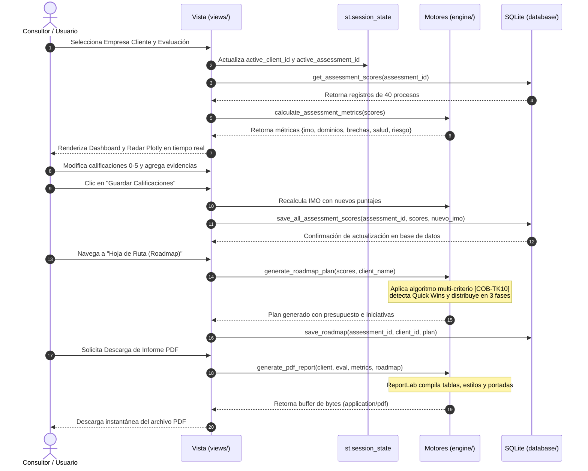
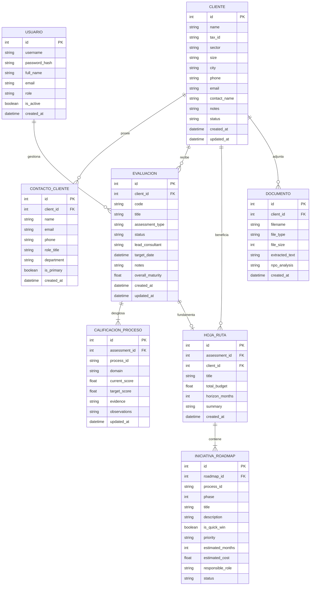

# 🏛️ MANUAL TÉCNICO, ARQUITECTURA Y ESPECIFICACIÓN FUNCIONAL
## SISTEMA DE CONSULTORÍA EN GOBIERNO Y GESTIÓN DE TI (COBIT 2019 + IA) — CORE APP

**Universidad del Quindío — Facultad de Ingeniería**  
**Programa:** Ingeniería de Sistemas y Computación  
**Asignatura:** Formulación de Proyectos de Software (8vo Semestre)  
**Equipo Consultor / Desarrollador:** Johan Londoño, Julián Hoyos, Kevin García  
**Marco de Referencia:** COBIT 2019 (ISACA) & Cronograma Jira (`CRONOGRAMA_REQUISITOS_JIRA_COBIT.txt`)

---

## 📑 TABLA DE CONTENIDO
1. [Resumen Ejecutivo y Propósito del Sistema](#1-resumen-ejecutivo-y-propósito-del-sistema)
2. [Arquitectura del Sistema y Flujo de Comunicación](#2-arquitectura-del-sistema-y-flujo-de-comunicación)
   - 2.1. [Propósito de la Arquitectura](#21-propósito-de-la-arquitectura)
   - 2.2. [Diagrama General de Arquitectura por Capas y Módulos](#22-diagrama-general-de-arquitectura-por-capas-y-módulos)
   - 2.3. [Recorrido de las Solicitudes y Respuestas](#23-recorrido-de-las-solicitudes-y-respuestas-ciclo-de-vida-de-petición)
   - 2.4. [Leyenda de Conexiones, Tipos de Línea y Código de Colores](#24-leyenda-de-conexiones-tipos-de-línea-y-código-de-colores)
   - 2.5. [Suposiciones Relevantes de Arquitectura](#25-suposiciones-relevantes-de-arquitectura)
   - 2.6. [Componentes Estructurales Preexistentes](#26-componentes-estructurales-preexistentes)
3. [Flujo de Datos y Comunicación entre Módulos](#3-flujo-de-datos-y-comunicación-entre-módulos)
4. [Catálogo Detallado de Funcionalidades (Lo que puede hacer el Usuario)](#4-catálogo-detallado-de-funcionalidades-lo-que-puede-hacer-el-usuario)
5. [Modelos y Tipos de Datos del Sistema](#5-modelos-y-tipos-de-datos-del-sistema)
   - 5.1. [Diccionario de Datos Relacionales (SQLite)](#51-diccionario-de-datos-relacionales-sqlite-cobit_coredb)
   - 5.2. [Estructuras de Datos en Memoria](#52-estructuras-de-datos-en-memoria-python-engine)
   - 5.3. [Modelo de datos de la base de datos](#53-modelo-de-datos-de-la-base-de-datos)
6. [Motores de Cálculo y Algoritmos Matemáticos](#6-motores-de-cálculo-y-algoritmos-matemáticos)
7. [Guía de Ejecución, Roles y Pruebas Automatizadas](#7-guía-de-ejecución-roles-y-pruebas-automatizadas)

---

## 1. RESUMEN EJECUTIVO Y PROPÓSITO DEL SISTEMA

El **COBIT Core Consulting System** es una plataforma web y analítica diseñada para automatizar el ciclo integral de consultoría en Gobierno y Gestión de Tecnologías de Información basándose en las directrices oficiales de **COBIT 2019 (ISACA)**.

El sistema resuelve la problemática tradicional de las evaluaciones de madurez de TI: procesos manuales en hojas de cálculo propensas a errores, ausencia de trazabilidad probatoria, dificultad para traducir debilidades operativas en valor de negocio y demoras excesivas en la formulación de hojas de ruta de transformación digital.

### Objetivos Primordiales Cumplidos:
- **Centralización Corporativa:** Gestión estructurada de clientes empresariales clasificados por sector económico y tamaño.
- **Rigor Metodológico COBIT 2019:** Integración de los 5 dominios oficiales (**EDM, APO, BAI, DSS, MEA**) y los 40 objetivos de gobierno y gestión.
- **Medición Cuantitativa Estandarizada:** Evaluación en escala de capacidad 0 a 5 con cálculo automatizado del **Índice de Madurez Organizacional (IMO)**.
- **Inteligencia Analítica y NLP:** Diagnóstico heurístico de brechas (*Gaps*), extracción de Necesidades, Problemas y Oportunidades (**NPO**) desde documentos y alineación estratégica de metas del negocio a TI.
- **Planificación Estratégica:** Generación automática de hojas de ruta secuenciadas en 3 fases temporales con priorización de **Quick Wins** e inversión estimada.
- **Entregables Ejecutivos de Alto Impacto:** Tableros visuales con gráficos Radar Plotly y exportación directa de informes en **PDF formal** y hojas de cálculo **Excel (.xlsx)**.

---

## 2. ARQUITECTURA DEL SISTEMA Y FLUJO DE COMUNICACIÓN

> [!NOTE]
> **Alcance y Precisión Arquitectónica:** Conforme a las directrices metodológicas de diseño por capas y tras contrastar los procesos y funcionalidades del sistema, esta sección formaliza la **Arquitectura Lógica Modular por Capas** del **COBIT Core Consulting System (COBIT 2019 + IA)**. Se modelan los 3 perfiles de usuario, las 8 vistas de presentación, el orquestador reactivo de aplicación, los 5 motores de lógica de negocio, la capa de acceso a datos (DAL), la persistencia relacional SQLite y los servicios externos de generación documental y visualización.

### 2.1. Propósito de la Arquitectura
El propósito primordial de esta arquitectura es desacoplar las responsabilidades funcionales y técnicas del sistema en una estructura por capas estricta y modular. Esto garantiza:
1. **Separación de Responsabilidades (SoC):** La interfaz de usuario (`views/`) desconoce los detalles de persistencia SQL, interactuando únicamente a través del orquestador central (`app.py`) y los motores de cálculo (`engine/`).
2. **Determinismo y Testabilidad:** Toda la lógica matemática (cálculo de IMO [COB-TK08], priorización de hojas de ruta [COB-TK10], diagnóstico de brechas y minería NPO) reside en funciones puras e independientes de Streamlit, permitiendo la ejecución de suites de prueba automatizadas sin levantar la interfaz gráfica.
3. **Seguridad y Control de Acceso:** La coordinación de peticiones aplica control de acceso basado en roles (**RBAC**) y protección criptográfica (hashing SHA-256), mientras que la capa de persistencia asegura transacciones ACID y protección contra inyección SQL mediante consultas parametrizadas.
4. **Integración Desacoplada de Servicios:** Los generadores de documentos (PDF ejecutivo con ReportLab y hojas de cálculo con OpenPyXL) operan como servicios utilitarios que producen flujos de bytes en memoria (`io.BytesIO`), evitando escrituras temporales en disco y optimizando el rendimiento.

---

### 2.2. Diagrama General de Arquitectura por Capas y Módulos

El siguiente diagrama en sintaxis **Mermaid (`flowchart TB`)** ilustra la organización por capas, los componentes modulares y el flujo bidireccional de comunicación entre actores, interfaz, controladores, lógica de negocio, persistencia y servicios externos:

```mermaid
flowchart TB
    %% ==========================================
    %% CAPA 1: USUARIOS Y SISTEMAS DE ENTRADA
    %% ==========================================
    subgraph CAPA1["Capa 1: Usuarios y Sistemas de Entrada"]
        U_ADMIN["👑 Superadministrador<br/>(Admin: Configuración y Auditoría)"]
        U_CONS["💼 Consultor Líder<br/>(Evaluador: Operación y Análisis)"]
        U_CLI["🏢 Cliente Corporativo<br/>(Directivo / CIO: Consulta y KPIs)"]
        DISPOSITIVOS["💻 Dispositivos de Acceso<br/>(Navegador Web Desktop / Portátil / Tablet)"]
    end

    %% ==========================================
    %% CAPA 2: PRESENTACIÓN E INTERFACES DE USUARIO
    %% ==========================================
    subgraph CAPA2["Capa 2: Presentación e Interfaces de Usuario (Views)"]
        V_DASH["📊 Dashboard y Radar Polar<br/>(views/dashboard_view.py)"]
        V_CLI["🏢 Gestión de Clientes y Contactos<br/>(views/clients_view.py)"]
        V_CAT["📚 Catálogo COBIT 2019 (40 Proc)<br/>(views/catalog_view.py)"]
        V_ASS["📝 Cuestionario de Madurez 0-5<br/>(views/assessment_view.py)"]
        V_DIAG["🤖 Diagnóstico y Asistente IA<br/>(views/diagnosis_view.py)"]
        V_ROAD["🗺️ Hoja de Ruta Estratégica<br/>(views/roadmap_view.py)"]
        V_DOCS["📄 Ingesta Documental NLP<br/>(views/documents_view.py)"]
        V_REP["📥 Centro de Reportes Formales<br/>(views/reports_view.py)"]
    end

    %% ==========================================
    %% CAPA 3: APLICACIÓN Y COORDINACIÓN
    %% ==========================================
    subgraph CAPA3["Capa 3: Aplicación y Coordinación de Solicitudes"]
        ROUTER["⚙️ Orquestador Central de Aplicación (app.py)<br/>• Enrutamiento dinámico de vistas y ciclo de vida<br/>• Control de acceso RBAC y autenticación SHA-256<br/>• Gestión de contexto de sesión reactivo (st.session_state)<br/>• Sanitización y validación formal de entradas"]
    end

    %% ==========================================
    %% CAPA 4: LÓGICA DE NEGOCIO Y MÓDULOS FUNCIONALES
    %% ==========================================
    subgraph CAPA4["Capa 4: Lógica de Negocio y Módulos Funcionales (Engine)"]
        M_MAT["📐 Motor de Madurez y Gobernanza<br/>(maturity_engine.py)<br/>Algoritmo IMO [TK08], salud y riesgo"]
        M_AI["🧠 Motor de Inteligencia y NLP<br/>(ai_engine.py)<br/>Detección de brechas y minería NPO"]
        M_ROAD["📈 Motor de Hoja de Ruta Estratégica<br/>(roadmap_engine.py)<br/>Priorización [TK10], Quick Wins y fases"]
        M_DATA["🏛️ Catálogo Maestro COBIT 2019<br/>(cobit_data.py)<br/>40 objetivos oficiales y 5 dominios"]
        M_EXP["📦 Motor de Entregables y Exportación<br/>(export_engine.py)<br/>Formateo y estructura ejecutiva"]
    end

    %% ==========================================
    %% CAPA 5: ACCESO A DATOS Y PERSISTENCIA (DAL)
    %% ==========================================
    subgraph CAPA5["Capa 5: Acceso a Datos y Persistencia (DAL)"]
        DAL_MGR["🔌 Capa de Persistencia (db_manager.py)<br/>• Pool y transacciones SQLite seguras con contextmanager<br/>• Integridad referencial activa (PRAGMA foreign_keys = ON)<br/>• Consultas SQL parametrizadas contra inyección SQL<br/>• Inicialización DDL y sembrado de datos idempotente"]
    end

    %% ==========================================
    %% CAPA 6: BASE DE DATOS RELACIONAL
    %% ==========================================
    subgraph CAPA6["Capa 6: Base de Datos Relacional (Storage)"]
        DB_SQL[("💾 Base de Datos SQLite (cobit_core.db)<br/>• users: Credenciales, nombres y roles<br/>• clients & client_contacts: Empresas y actores<br/>• assessments & assessment_scores: Evaluaciones e IMO<br/>• roadmaps & roadmap_initiatives: Planes de acción<br/>• documents: Metadatos y evidencias NLP")]
    end

    %% ==========================================
    %% CAPA 7: SERVICIOS E INTEGRACIONES DE SALIDA
    %% ==========================================
    subgraph CAPA7["Capa 7: Servicios e Integraciones de Salida"]
        EXT_PDF["📄 Motor PDF (ReportLab)<br/>Compilación formal de reportes ejecutivos"]
        EXT_XLS["📊 Motor Excel (OpenPyXL / Pandas)<br/>Generación de matrices de madurez .xlsx"]
        EXT_PLOT["📈 Motor Plotly.js / Streamlit<br/>Renderizado interactivo de gráficos radar polar"]
        EXT_PARSE["📑 Parsers PyPDF / Python-Docx<br/>Extracción de texto para minería NLP"]
        EXT_AI["🌐 Motor IA / NLP Externo (Opcional)<br/>Servicio de modelos LLM vía API segura"]
    end

    %% ==========================================
    %% CONEXIONES Y FLUJOS ENTRE CAPAS
    %% ==========================================
    %% Capa 1 -> Capa 2
    U_ADMIN -->|"Sesión administrativa (RBAC)"| DISPOSITIVOS
    U_CONS -->|"Sesión consultor / evaluador"| DISPOSITIVOS
    U_CLI -->|"Sesión cliente corporativo"| DISPOSITIVOS
    DISPOSITIVOS -->|"Renderiza / Interactúa"| V_DASH
    DISPOSITIVOS -->|"Renderiza / Interactúa"| V_CLI
    DISPOSITIVOS -->|"Renderiza / Interactúa"| V_ASS
    DISPOSITIVOS -->|"Renderiza / Interactúa"| V_DIAG
    DISPOSITIVOS -->|"Renderiza / Interactúa"| V_ROAD
    DISPOSITIVOS -->|"Renderiza / Interactúa"| V_DOCS
    DISPOSITIVOS -->|"Renderiza / Interactúa"| V_REP
    DISPOSITIVOS -->|"Renderiza / Interactúa"| V_CAT

    %% Capa 2 -> Capa 3
    V_DASH -->|"Solicitud de KPIs"| ROUTER
    V_CLI -->|"CRUD clientes"| ROUTER
    V_CAT -->|"Consulta procesos"| ROUTER
    V_ASS -->|"Guarda calificaciones"| ROUTER
    V_DIAG -->|"Solicita análisis IA"| ROUTER
    V_ROAD -->|"Solicita generar plan"| ROUTER
    V_DOCS -->|"Carga actas/auditorías"| ROUTER
    V_REP -->|"Solicita reporte"| ROUTER

    %% Capa 3 -> Capa 4
    ROUTER -->|"1. Despacha cálculo IMO y salud"| M_MAT
    ROUTER -->|"2. Despacha análisis semántico y NPO"| M_AI
    ROUTER -->|"3. Despacha algoritmo priorización"| M_ROAD
    ROUTER -->|"4. Consulta catálogo 40 procesos"| M_DATA
    ROUTER -->|"5. Solicita compilación de informe"| M_EXP

    %% Capa 4 -> Capa 5
    M_MAT -->|"Consulta / Actualiza puntajes"| DAL_MGR
    M_ROAD -->|"Registra planes e iniciativas"| DAL_MGR
    M_AI -->|"Consulta textos y evidencias"| DAL_MGR
    ROUTER -->|"CRUD usuarios, clientes y empresas"| DAL_MGR

    %% Capa 5 -> Capa 6
    DAL_MGR -->|"Ejecución SQL (INSERT / UPDATE / SELECT)"| DB_SQL
    DB_SQL -.->|"Retorno de tuplas y registros"| DAL_MGR

    %% Retorno de DAL a Capa 4 y Capa 3
    DAL_MGR -.->|"Devuelve entidades y registros persistidos"| ROUTER

    %% Capa 4 -> Capa 7 (Servicios de Salida)
    M_EXP -->|"Compila informe binario en memoria"| EXT_PDF
    M_EXP -->|"Genera matriz analítica tabular"| EXT_XLS
    ROUTER -->|"Alimenta coordenadas polares"| EXT_PLOT
    M_AI -->|"Extrae texto crudo estructurado"| EXT_PARSE
    M_AI -.->|"Consumo seguro opcional vía API"| EXT_AI

    %% Retornos hacia Capa 2 y Usuario
    ROUTER -.->|"Actualiza st.session_state y re-renderiza"| V_DASH
    ROUTER -.->|"Retorna buffer de descarga (BytesIO)"| V_REP
    V_DASH -.->|"Presenta KPIs y radar en pantalla"| DISPOSITIVOS
    V_REP -.->|"Entrega archivo formal descargable"| DISPOSITIVOS

    %% ==========================================
    %% ESTILOS VISUALES POR CAPAS
    %% ==========================================
    classDef c1 fill:#E1F5FE,stroke:#0288D1,stroke-width:2px,color:#01579B;
    classDef c2 fill:#EDE7F6,stroke:#5E35B1,stroke-width:2px,color:#311B92;
    classDef c3 fill:#E8F5E9,stroke:#2E7D32,stroke-width:2px,color:#1B5E20;
    classDef c4 fill:#FFF8E1,stroke:#F57C00,stroke-width:2px,color:#E65100;
    classDef c5 fill:#FCE4EC,stroke:#C2185B,stroke-width:2px,color:#880E4F;
    classDef c6 fill:#E0F2F1,stroke:#00796B,stroke-width:2px,color:#004D40;
    classDef c7 fill:#ECEFF1,stroke:#455A64,stroke-width:2px,color:#263238;

    class U_ADMIN,U_CONS,U_CLI,DISPOSITIVOS c1;
    class V_DASH,V_CLI,V_CAT,V_ASS,V_DIAG,V_ROAD,V_DOCS,V_REP c2;
    class ROUTER c3;
    class M_MAT,M_AI,M_ROAD,M_DATA,M_EXP c4;
    class DAL_MGR c5;
    class DB_SQL c6;
    class EXT_PDF,EXT_XLS,EXT_PLOT,EXT_PARSE,EXT_AI c7;
```



---

### 2.3. Recorrido de las Solicitudes y Respuestas (Ciclo de Vida de Petición)

Para garantizar la comprensión integral de la dinámica operativa del sistema, a continuación se describen los cuatro flujos más representativos de solicitud y respuesta:

#### Flujo 1: Evaluación de Madurez y Recálculo del IMO en Tiempo Real
1. **Petición del Usuario:** El Consultor Líder ajusta el control deslizante (*slider*) de madurez del proceso `EDM01` de nivel 2 a nivel 4 e ingresa el hallazgo de auditoría en `views/assessment_view.py`. Al presionar el botón *"💾 Guardar Calificaciones y Recalcular"*, la vista emite un evento al coordinador.
2. **Coordinación y Validación:** El Orquestador Central (`app.py`) verifica que el usuario posea el rol `consultant` o `admin`, sanitiza los puntajes recibidos y actualiza el diccionario contextual en memoria.
3. **Procesamiento de Negocio:** `app.py` delega el cálculo matemático a `maturity_engine.py:calculate_assessment_metrics()`, el cual ejecuta el algoritmo del Índice de Madurez Organizacional (**IMO**), computando el promedio ponderado por dominios (**EDM, APO, BAI, DSS, MEA**), el porcentaje de Salud de Gobernanza y el índice de Exposición al Riesgo de TI.
4. **Persistencia Transaccional:** `app.py` invoca la capa de persistencia `database/db_manager.py:save_all_assessment_scores()`, la cual abre una transacción ACID, ejecuta `UPDATE` parametrizados sobre la tabla `assessment_scores` y actualiza el campo `overall_score` en la tabla `assessments`.
5. **Retorno y Re-renderizado:** La base de datos confirma la transacción; `app.py` actualiza las métricas en `st.session_state` y redirige el flujo hacia la interfaz, donde `views/dashboard_view.py` recibe los nuevos valores e invoca a `Plotly.js` para redibujar el polígono polar radar y actualizar los KPIs de forma instantánea.

#### Flujo 2: Ingesta Documental, Minería NPO y Correlación Semántica (NLP)
1. **Carga del Archivo o Texto:** En `views/documents_view.py`, el usuario sube un archivo de informe de auditoría (`.pdf`, `.docx`, `.txt`, `.md`, `.json`, `.csv`) o pega un texto institucional.
2. **Extracción y Normalización:** La vista transfiere el flujo binario a `ai_engine.py`, el cual utiliza los parsers documentales (`pypdf` o `python-docx`) para extraer el texto plano sin estructurar y eliminar ruido textual.
3. **Minería de Lenguaje Natural y Detección NPO:** El motor aplica análisis sintáctico-semántico con expresiones regulares avanzadas para clasificar los hallazgos en la matriz **NPO (Necesidades, Problemas, Oportunidades)**, calcula un **Índice de Urgencia/Severidad cuantitativo (0 a 100%)**, detecta menciones de infraestructura/tecnologías y vectoriza el texto mediante **TF-IDF + Similitud Coseno** contra los 40 objetivos COBIT 2019 para identificar con exactitud los procesos impactados.
4. **Almacenamiento de Evidencias:** `db_manager.py:save_document()` registra el archivo y el resultado NPO estructurado en formato JSON en la tabla `documents` vinculándolo con el `client_id` activo.
5. **Presentación de Resultados:** La interfaz muestra las tarjetas métricas (severidad, tecnologías, procesos mapeados) y la tabla de hallazgos NPO extraídos, integrando estos datos posteriormente en el diagnóstico y la hoja de ruta.

#### Flujo 3: Generación Algorítmica Multi-Criterio de la Hoja de Ruta (Roadmap)
1. **Solicitud de Generación y Parametrización:** El consultor ingresa a `views/roadmap_view.py`, ajusta la estrategia de optimización (Equilibrado, Quick Wins, Ciberseguridad/Continuidad o Gobierno Directivo), el horizonte (12, 18 o 24 meses) y la tolerancia de inversión.
2. **Procesamiento Multi-criterio (MCDA / AHP + WSJF):** `roadmap_engine.py:generate_roadmap_plan()` consulta las brechas activas de madurez ($Gap = Meta - Actual$), el tamaño y sector de la empresa, y los hallazgos documentales NLP. Aplica el modelo de priorización:
   $$\text{WSJF} = \frac{\text{Impacto}^{1.15}}{\text{Esfuerzo}^{0.85}}$$
   donde el Impacto ($1.0-10.0$) y el Esfuerzo ($1.0-10.0$) se calculan mediante funciones multi-variables y penalizaciones de evidencia.
3. **Detección Algorítmica de Quick Wins y Estimación Paramétrica:** El motor clasifica automáticamente las iniciativas de alto impacto y bajo esfuerzo ejecutable en menos de 90 días como **Quick Wins**, calcula el presupuesto paramétrico en COP en función del salto de madurez y el multiplicador de escala empresarial, asigna roles institucionales y distribuye las actividades en 3 fases temporales (Meses 1-3, 4-8, 9-18).
4. **Persistencia Estructurada:** La capa DAL (`save_roadmap()`) guarda el encabezado en `roadmaps` y cada iniciativa en `roadmap_initiatives`.
5. **Renderizado Visual:** La vista presenta las tarjetas interactivas de Quick Wins con su justificación algorítmica, los presupuestos estimados por fase y los desgloses técnicos de alcance y entregables.

#### Flujo 4: Compilación y Descarga de Entregables Ejecutivos (PDF / Excel)
1. **Petición de Exportación:** En `views/reports_view.py`, el usuario presiona *"Descargar Informe Ejecutivo Formal (PDF)"*.
2. **Recolección de Información:** `app.py` recupera de `db_manager.py` los datos completos de la empresa cliente, la evaluación de madurez, las calificaciones de los 40 procesos y la hoja de ruta generada.
3. **Compilación Documental:** `export_engine.py:generate_pdf_report()` activa la librería `ReportLab`, generando programáticamente la portada institucional, las tablas estilizadas de madurez y el cronograma del roadmap dentro de un búfer de memoria (`io.BytesIO`).
4. **Entrega de Archivo:** El búfer binario es devuelto a Streamlit, el cual provee el botón de descarga nativo del navegador, permitiendo al usuario guardar el archivo localmente sin persistencia residual en el servidor.

---

### 2.4. Leyenda de Conexiones, Tipos de Línea y Código de Colores

Para facilitar la interpretación inequívoca del diagrama de arquitectura, se detalla la semántica de la simbología empleada:

| Elemento Visual | Sintaxis Mermaid | Significado Arquitectónico |
| :--- | :--- | :--- |
| **Flecha Sólida (`-->`)** | `A -->\|Etiqueta\| B` | **Flujo Síncrono Directo / Comando:** Representa una invocación directa, envío de eventos, operaciones de escritura SQL o peticiones dirigidas al controlador. |
| **Flecha Punteada (`-.->`)** | `A -.->\|Etiqueta\| B` | **Flujo de Retorno / Renderizado:** Representa la entrega de datos procesados, retorno de registros relacionales, actualización del estado en memoria o entrega de archivos descargables. |
| **Nodos Rectangulares (`[...]`)** | `ID["Texto"]` | Componentes de software, controladores, vistas o módulos de lógica de negocio. |
| **Nodos Cilíndricos (`[(...)]`)** | `ID[("Texto")]` | Componentes de persistencia física y almacenamiento en base de datos relacional. |

#### Código de Colores por Capas:
- 🔵 **Azul Claro (`#E1F5FE` / `#0288D1`):** *Capa 1 — Usuarios y Sistemas de Entrada.* Representa los actores humanos y los dispositivos de cliente.
- 🟣 **Púrpura Suave (`#EDE7F6` / `#5E35B1`):** *Capa 2 — Presentación (Views).* Identifica las interfaces y pantallas especializadas del sistema.
- 🟢 **Verde Esmeralda (`#E8F5E9` / `#2E7D32`):** *Capa 3 — Aplicación y Coordinación.* Destaca el orquestador central (`app.py`), responsable de la seguridad y el enrutamiento.
- 🟠 **Ámbar / Naranja (`#FFF8E1` / `#F57C00`):** *Capa 4 — Lógica de Negocio y Motores (Engine).* Identifica los algoritmos matemáticos puros y los catálogos metodológicos.
- 🔴 **Rosa / Magenta (`#FCE4EC` / `#C2185B`):** *Capa 5 — Acceso a Datos (DAL).* Destaca el módulo de persistencia y abstracción SQL.
- 🟢 **Verde Azulado / Teal (`#E0F2F1` / `#00796B`):** *Capa 6 — Base de Datos Relacional.* Representa el almacenamiento en disco SQLite 3.
- ⚫ **Gris Pizarra (`#ECEFF1` / `#455A64`):** *Capa 7 — Servicios e Integraciones de Salida.* Representa motores externos y bibliotecas de formato.

---

### 2.5. Suposiciones Relevantes de Arquitectura

1. **Propuesta Lógica vs. Ejecución Física:** La arquitectura propuesta organiza lógicamente el sistema en siete capas bien diferenciadas. En el despliegue físico actual, la aplicación se ejecuta como un servicio monolítico modular en Python 3.10+, donde las capas residen en el mismo entorno de ejecución pero mantienen fronteras de código estrictamente desacopladas mediante módulos de software.
2. **Gestión de Estado en Memoria (Stateful UI):** Dado el modelo reactivo de Streamlit, la coordinación de solicitudes apoya la continuidad del usuario en `st.session_state`, garantizando que variables como la empresa cliente activa (`active_client_id`) y la evaluación en curso (`active_assessment_id`) no requieran ser reconsultadas en cada ciclo de vida visual.
3. **Persistencia Local Relacional:** El sistema utiliza SQLite 3 (`cobit_core.db`) como motor de base de datos relacional embebido, garantizando cero configuración y portabilidad absoluta. La integridad referencial se fuerza explícitamente en cada conexión mediante `PRAGMA foreign_keys = ON`.
4. **Desacoplamiento Estricto de Motores:** La capa de lógica de negocio (`engine/`) no tiene dependencias cruzadas con la capa de presentación (`views/` ni `streamlit`). Esto permite que los motores puedan reutilizarse en interfaces de línea de comandos (CLI), APIs REST futuras o suites de integración continua.
5. **Operaciones de Exportación Efímeras:** Los motores de generación documental (ReportLab y OpenPyXL) trabajan exclusivamente con flujos de bytes en memoria (`io.BytesIO`), garantizando que los archivos generados no consuman espacio en disco ni expongan información corporativa confidencial en directorios temporales del servidor.
6. **IA Híbrida (Heurística Local + Proveedor Opcional):** El procesamiento de lenguaje natural (NLP) opera de manera autónoma y determinística utilizando heurística local de expresiones regulares y taxonomía COBIT, con la arquitectura preparada para delegar inferencias complejas a modelos LLM externos (OpenAI o Google Gemini) mediante interfaces abstractas y seguras.

---

### 2.6. Componentes Estructurales Preexistentes

La aplicación adopta una arquitectura modular desacoplada en tres capas fundamentales (**Layered Architecture**), asegurando separación estricta de responsabilidades, alta mantenibilidad y portabilidad:

```
┌────────────────────────────────────────────────────────────────────────┐
│                   CAPA 1: PRESENTACIÓN E INTERFAZ (VIEWS)              │
│  app.py (Router & Session State) | custom.css (Design System Moderno)  │
│  ┌───────────────┬────────────────┬────────────────┬────────────────┐  │
│  │ Dashboard View│  Clients View  │  Catalog View  │ Assessment View│  │
│  ├───────────────┼────────────────┼────────────────┼────────────────┤  │
│  │ Diagnosis View│  Roadmap View  │ Documents View │  Reports View  │  │
│  └───────────────┴────────────────┴────────────────┴────────────────┘  │
└───────────────────────────────────┬────────────────────────────────────┘
                                    │ Invoca servicios y pasa estado
                                    ▼
┌────────────────────────────────────────────────────────────────────────┐
│               CAPA 2: LÓGICA DE NEGOCIO Y MOTORES (ENGINE)             │
│  ┌───────────────────────┬───────────────────────┬──────────────────┐  │
│  │ cobit_data.py         │ maturity_engine.py    │ ai_engine.py     │  │
│  │ (40 procesos COBIT)   │ (Algoritmo IMO [TK08])│ (NLP NPO & Gaps) │  │
│  ├───────────────────────┴───────────────────────┴──────────────────┤  │
│  │ roadmap_engine.py ([COB-TK10] Multi-criterio & Quick Wins)       │  │
│  │ export_engine.py ([COB-ST19/ST20] ReportLab PDF & OpenPyXL Excel)│  │
│  └──────────────────────────────────────────────────────────────────┘  │
└───────────────────────────────────┬────────────────────────────────────┘
                                    │ Lee y persiste entidades
                                    ▼
┌────────────────────────────────────────────────────────────────────────┐
│               CAPA 3: PERSISTENCIA Y DATOS (DATABASE)                  │
│  db_manager.py (Conexiones, Migraciones DDL, Consultas Parametrizadas) │
│  cobit_core.db (SQLite 3 Relacional con llaves foráneas e integridad)  │
└────────────────────────────────────────────────────────────────────────┘
```

### Componentes de la Estructura:
1. **`app.py` (Orquestador Central):**
   - Configura el entorno Streamlit (`wide mode`, favicon, metadatos).
   - Inyecta el sistema de diseño visual unificado (`static/custom.css`).
   - Gobierna el ciclo de vida de la sesión (`st.session_state`) y el control de acceso por roles (**RBAC**).
   - Enruta hacia la vista seleccionada sin recargas destructivas de estado.
2. **`views/` (Vistas de Usuario):** Módulos desacoplados que renderizan formularios, tablas interactivas, sliders de puntuación y gráficos. Cada vista es una función pura que interactúa con la lógica de negocio.
3. **`engine/` (Motores de Cálculo y Lógica Pura):** Contiene las funciones determinísticas y matemáticas independientes del framework de interfaz gráfica. Esto permite probar el 100% de la lógica sin levantar la UI.
4. **`database/` (Capa de Acceso a Datos):** Encapsula las transacciones SQLite, control de integridad referencial (`PRAGMA foreign_keys = ON`), hashing de credenciales (SHA-256) y sembrado automático de datos iniciales (*idempotent seeding*).

---

## 3. FLUJO DE DATOS Y COMUNICACIÓN ENTRE MÓDULOS

### 3.1. Gestión del Estado de Sesión (`st.session_state`)
Streamlit ejecuta el script de arriba a abajo ante cada interacción del usuario. Para garantizar coherencia y persistencia sin perder selecciones, el sistema utiliza variables de contexto globales:

- `st.session_state["authenticated"]` (Booleano): Bandera de inicio de sesión seguro.
- `st.session_state["user"]` (Diccionario): Datos del usuario autenticado (`id`, `username`, `full_name`, `role`).
- `st.session_state["current_view"]` (String): Identificador de la vista activa (`dashboard`, `clients`, `assessment`, etc.).
- `st.session_state["active_client_id"]` (Entero): ID de la empresa seleccionada como contexto de trabajo.
- `st.session_state["active_assessment_id"]` (Entero): ID de la evaluación activa que alimenta los tableros y cálculos.

### 3.2. Diagrama de Secuencia: Flujo Integral de Evaluación y Generación de Entregables



---

## 4. CATÁLOGO DETALLADO DE FUNCIONALIDADES (LO QUE PUEDE HACER EL USUARIO)

### 4.1. Módulo de Autenticación y Control de Acceso por Roles (RBAC) [COB-ST01, COB-ST03]
- **Inicio de Sesión Seguro:** Interfaz protegida contra credenciales erróneas mediante hash SHA-256.
- **Acceso según Perfiles:**
  - **👑 Administrador (`admin`):** Gestión completa de la plataforma, mantenimiento y visualización total.
  - **💼 Consultor Líder (`consultant`):** Registro de clientes, configuración de cuestionarios, ejecución de evaluaciones, ejecución de diagnósticos de IA y generación de hojas de ruta.
  - **🏢 Cliente Corporativo (`client`):** Lectura directiva, monitoreo de indicadores del dashboard y descarga de informes de su respectiva empresa.
- **Credenciales Demo Integradas:** Ayuda visual con tarjetas de acceso rápido para demostraciones académicas inmediatas.
- **Cierre de Sesión:** Destruye el estado de sesión y retorna a la pantalla de validación.

---

### 4.2. Dashboard Ejecutivo con Radar COBIT 2019 [COB-ST16, COB-ST17]
- **Selector de Contexto:** Menú desplegable para alternar entre diferentes empresas clientes y sus respectivas evaluaciones vigentes.
- **Tarjetas de Indicadores Clave (KPIs):**
  - **Índice de Madurez Organizacional (IMO):** Calificación ponderada de 0.00 a 5.00 con su respectivo nivel verbal oficial (Incompleto, Inicial, Gestionado, Establecido, Predecible u Optimizado).
  - **Meta Propuesta y Brecha Global:** Objetivo corporativo (ej. 3.50/5.00) y distancia numérica por cerrar.
  - **Salud de Gobernanza (%):** Nivel porcentual de efectividad y alineación de las prácticas de gobierno de TI.
  - **Exposición al Riesgo de TI (%):** Brecha de vulnerabilidad no mitigada calculada de forma complementaria al IMO.
- **Gráfico Radar Polar Interactivo (Plotly):**
  - Polígono de 5 ejes correspondiente a los 5 dominios COBIT (**EDM, APO, BAI, DSS, MEA**).
  - Dos capas superpuestas: **Nivel Actual Evaluado** (azul traslúcido) vs **Nivel Deseado / Meta** (verde punteado).
  - Escala fija de 0 a 5 con etiquetas legibles y *tooltips* interactivos al pasar el cursor.
- **Barras de Desempeño por Dominio:** Barras de progreso porcentuales por área de gobierno y gestión con desglose de la brecha.
- **Tabla de Alerta Temprana (Top 5 Brechas Críticas):** Destaca de forma automática los 5 procesos que presentan la mayor diferencia entre el nivel actual y el requerido.
- **Accesos Directos de Navegación:** Botones rápidos hacia el Cuestionario, Diagnóstico de IA, Hoja de Ruta y Reportes.

---

### 4.3. Gestión Integral de Empresas Clientes y Contactos [COB-ST04, COB-ST05]
- **Pestaña 1: Listado y Filtros Avanzados:**
  - Buscador predictivo en tiempo real por Razón Social, NIT o Ciudad de sede.
  - Filtro desplegable por sector industrial (Banca, Salud, Tecnología, Manufactura, Retail, etc.).
  - Acordeones informativos por empresa destacando la empresa **ACTIVA EN SESIÓN**.
  - Operaciones en un clic: Establecer como cliente activo, editar datos y eliminar cliente con eliminación en cascada.
- **Pestaña 2: Registro de Nueva Organización:**
  - Formulario validado para registrar Razón Social, NIT/RUT, Sector Económico, Tamaño Corporativo (Micro a Multinacional), Sede, Teléfonos, Correo institucional y Contacto Principal.
  - Asignación inmediata como empresa activa al guardar.
- **Pestaña 3: Directorio de Interesados y Contactos Clave:**
  - Asociación de múltiples interesados por empresa (CIO, CISO, Auditor Interno, Gerente de Operaciones).
  - Registro de nombres, correo, teléfono, cargo, área y designación del **Contacto Principal**.

---

### 4.4. Catálogo Interactivo COBIT 2019 [COB-TK05, COB-ST07]
- **Explorador Oficial de ISACA:** Presenta los 5 dominios y los 40 procesos del estándar en español.
- **Filtrado por Dominio:** Selector para aislar los procesos de gobierno (EDM) o de gestión (APO, BAI, DSS, MEA).
- **Buscador Universal en Vivo:** Búsqueda por coincidencia de código (ej. `DSS05`, `APO13`), término funcional (`ciberseguridad`, `riesgo`, `continuidad`, `datos`) o prácticas.
- **Tarjetas Resumen de Dominio:** Cajas de color con contadores dinámicos de procesos por cada área.
- **Ficha Técnica Expandible por Proceso:**
  - Código y nombre oficial.
  - Indicador de **Proceso Core / Esencial**.
  - Propósito formal del objetivo según COBIT 2019.
  - Prácticas clave recomendadas para auditar en campo.

---

### 4.5. Cuestionario Interactivo de Evaluación de Madurez [COB-ST10, COB-ST11]
- **Creación de Expedientes de Evaluación:**
  - Posibilidad de crear múltiples evaluaciones por cliente para seguimiento temporal de avances.
  - **Alcance Flexible:** Selección entre **Diagnóstico Integral** (los 40 procesos) o **Diagnóstico Rápido / Quick Assessment** (18 procesos críticos seleccionados).
  - Asignación del Consultor Líder responsable y fecha objetivo de culminación.
- **Pestañas por Dominio:** Organización por pestañas (**EDM, APO, BAI, DSS, MEA**) que evita la fatiga visual del consultor.
- **Calificación en Escala Oficial 0 a 5:**
  - *Sliders* interactivos con saltos decimales de 0.5.
  - **Rúbrica Dinámica:** Al deslizar el valor, el sistema muestra en pantalla la definición de la escala:
    - `0`: Incompleto
    - `1`: Inicial
    - `2`: Gestionado
    - `3`: Establecido / Definido
    - `4`: Predecible / Cuantitativamente Gestionado
    - `5`: Optimizado
- **Fijación de Meta Específica por Proceso:** Permite que un proceso tenga meta 4.0 y otro 3.0 según la criticidad del negocio.
- **Bitácora de Evidencias Probatorias y Observaciones:** Campos de texto por cada proceso para adjuntar nombres de políticas, actas de comité, fechas de auditoría y planes inmediatos.
- **Guardado en Lote y Recálculo en Vivo:** Botón principal que consolida todas las calificaciones en SQLite y recalcula instantáneamente el IMO.

---

### 4.6. Diagnóstico de Brechas e Inteligencia Artificial Semántica [COB-ST12, COB-ST13]
- **Pestaña 1: Diagnóstico Integral Multi-Fuente:**
  - Sintetiza 4 fuentes de datos: ficha corporativa del cliente, métricas cuantitativas globales (IMO, Salud, Riesgo), micro-datos de calificaciones y evidencias, y hallazgos documentales NLP.
  - Alerta sobre la **trazabilidad documental** calculando el porcentaje de procesos que cuentan con evidencias probatorias registradas.
  - Hallazgos detallados por dominio con semáforos de criticidad (🔴 Crítico, 🟡 Atención Requerida, 🟢 Favorable).
  - Recomendaciones dinámicas de acción inmediata generadas en función de las mayores brechas y áreas desatendidas.
- **Pestaña 2: Asistente de Alineación Estratégica con IA / NLP (TF-IDF + Coseno):**
  - Integra un modelo de espacio vectorial con `scikit-learn` entrenado sobre el corpus oficial de los 40 procesos COBIT 2019 (nombres, propósitos, dominios y prácticas).
  - Permite seleccionar retos preconfigurados o redactar objetivos estratégicos libres (ej. *"Expandir canales digitales reduciendo fraudes bancarios y tiempos de respuesta"*).
  - Calcula la **afinidad semántica porcentual (0% a 100%)** mediante similitud coseno, incorpora pesos sectoriales y categoriza la criticidad (*Alta*, *Media*, *Baja*).
  - Devuelve una tabla ejecutiva con la justificación semántica y la **práctica clave recomendada** de ISACA para viabilizar la meta.
- **Pestaña 3: Matriz Cuantitativa de Riesgos Tecnológicos y de Gobernanza:**
  - Evaluación cuantitativa de 5 ejes de riesgo empresarial:
    1. *Ciberseguridad y Protección de Datos* (`APO13`, `DSS05`, `APO14`).
    2. *Continuidad Operativa y Resiliencia ante Desastres* (`DSS04`, `DSS01`).
    3. *Gobernanza Estratégica y Rendimiento de Inversiones* (`EDM01`, `EDM02`, `APO02`).
    4. *Cumplimiento Normativo, Legal y Aseguramiento* (`MEA02`, `MEA03`).
    5. *Gestión de Servicios, SLAs y Control de Cambios* (`APO09`, `BAI06`, `DSS02`).
  - Cada riesgo reporta su nivel (**Crítico**, **Alto**, **Medio**, **Bajo**), el porcentaje de exposición calculado dinámicamente, la causa raíz derivada de las calificaciones reales y la acción de mitigación sugerida.

---

### 4.7. Generador Algorítmico de Hojas de Ruta (Roadmap), Gantt y Quick Wins [COB-TK10, COB-ST14, COB-ST15]
- **Panel de Control y Parametrización Algorítmica:**
  - Permite al consultor calibrar el motor antes de la generación seleccionando la **Estrategia de Optimización** (*Equilibrado*, *Priorizar Quick Wins*, *Enfocado en Ciberseguridad y Continuidad*, o *Enfocado en Gobierno Directivo*).
  - Configuración del horizonte temporal (12, 18 o 24 meses) y ajuste fino de la tolerancia de inversión financiera (0.7x a 1.4x).
- **Cálculo Matemático de Prioridad Multi-Criterio (WSJF / MCDA):**
  - Evalúa cada proceso con brecha calculando una función de **Impacto (1-10)** y **Esfuerzo (1-10)** que pondera brechas, procesos *Core*, sector económico y penalizaciones por ausencia de evidencias.
- **Determinación Algorítmica de Quick Wins (< 90 Días):**
  - Identifica matemáticamente las victorias tempranas de alto impacto relativo y bajo/medio esfuerzo operativo.
  - Cada Quick Win presenta su tarjeta destacada con justificación algorítmica (`qw_reason`), entregables previstos y costos calculados.
- **Grafo de Precedencias y Validación de Dependencias Bloqueantes:**
  - Modela la red de dependencias canónicas COBIT 2019 (ej. `EDM01` y `APO01` desbloquean `APO12` y `APO13`; `APO13` desbloquea `DSS05`).
  - Aplica un **algoritmo de relajación topológica** para asegurar que ninguna tarea dependiente inicie antes de la culminación de sus prerrequisitos.
  - Detecta ciclos mediante DFS y previene bloqueos circulares (`is_valid = True`).
- **Hitos Estratégicos de Control (Milestones):**
  - Programa puntos de control formales a lo largo del horizonte:
    - 🚩 **Hito 1 (Mes 3):** Cimientos y Cierre de Quick Wins.
    - 🚩 **Hito 2 (Mes 6/8):** Consolidación Operativa y Controles de Ciberseguridad.
    - 🚩 **Hito 3 (Mes Horizon):** Institucionalización y Auditoría Final de Madurez.
- **Diagrama de Gantt Interactivo (Plotly Express / Timeline):**
  - Renderiza barras cronológicas interactivas con fechas calendario de inicio y fin (`YYYY-MM-DD`).
  - Modos de coloración dinámica: por Fase Temporal o por Tipología (Quick Win vs Proyecto Estándar).
  - Líneas verticales punteadas rojas que demarcan los hitos clave.
  - Tooltips contextuales (*hover data*) con proceso, presupuesto COP, duración, rol responsable, dependencias bloqueantes e indicador de **🔥 Ruta Crítica**.
- **Estimación Paramétrica de Presupuesto en COP:**
  - Sustituye costos fijos por un modelo paramétrico que escala según el tamaño de la empresa (Micro, Pequeña, Mediana, Grande, Corporativa), el sector económico y la complejidad del salto de madurez.
- **Desglose en 3 Fases Temporales:**
  - **Fase 1: Cimientos y Quick Wins (Meses 1-3):** Victorias tempranas y aseguramiento de políticas básicas.
  - **Fase 2: Consolidación y Procesos Core (Meses 4-8):** Implementación de SGSI, metodologías de proyectos y DRP.
  - **Fase 3: Optimización y Monitoreo Continuo (Meses 9-18/24):** Gobierno de datos, tableros BI e innovación.

---

### 4.8. Ingesta Documental, Extracción de Tablas y Búsqueda FTS5 [COB-ST08, COB-TK07, COB-ST09]
- **Carga de Archivos de Evidencia:** Acepta documentos en formatos de texto (`.txt`, `.md`, `.json`, `.csv`, `.docx`, `.pdf`).
- **Verificación Criptográfica de Integridad (SHA-256):**
  - Calcula el hash SHA-256 del contenido binario para garantizar la inmutabilidad de las evidencias y alertar sobre documentos duplicados previamente cargados.
- **Extracción de Tablas Estructuradas (PDF y DOCX):**
  - Extrae y procesa automáticamente tablas incrustadas en informes y planes de TI utilizando `pdfplumber` (para PDF) y `python-docx` (para Word).
  - Convierte las tablas en estructuras interactivas (`st.dataframe`) con columnas y filas tipificadas, presentadas en pestañas y expanders.
- **Motor de Búsqueda de Texto Completo con SQLite FTS5:**
  - Tabla virtual indexada con tokenizador Unicode para consultas ultra rápidas.
  - Algoritmo de ranking de relevancia **BM25**.
  - Generación automática de **snippets contextuales** con resaltado visual (`<mark>`) de los términos buscados.
- **Diagnóstico de Capa de Texto y OCR Opcional:**
  - Identifica si el documento cuenta con capa digital nativa o si proviene de un escaneo sin texto digitalizado, enrutando a OCR (Tesseract) cuando esté configurado en el host.
- **Extracción NLP de Necesidades, Problemas y Oportunidades (NPO):**
  - Analiza la semántica textual buscando patrones lingüísticos de requerimientos, deficiencias y mejoras potenciales.
  - Clasifica los hallazgos en tres paneles diferenciados:
    - 🎯 **Necesidades (N):** Requisitos obligatorios no satisfechos.
    - ⚠️ **Problemas (P):** Fallas, desvíos operativos, retrasos o vulnerabilidades.
    - 💡 **Oportunidades (O):** Iniciativas de modernización y optimización.
- **Indicadores Cuantitativos NLP:**
  - **Índice de Urgencia / Severidad:** Métrica porcentual (0% a 100%) calculada según la densidad y criticidad de los problemas detectados en el texto.
  - **Detección de Conceptos y Tecnologías:** Extracción automática de menciones sobre Cloud, ERP, MFA, Firewalls, DRP, Active Directory, SLAs, etc.
- **Mapeo Vectorial a Procesos COBIT 2019:** Vincula el contenido del documento con los procesos oficiales mediante similitud semántica TF-IDF.
- **Historial Documental:** Repositorio histórico para consultar documentos cargados previamente por cliente con sus métricas, tablas y firmas SHA-256.
  - **Índice de Urgencia / Severidad:** Métrica porcentual (0% a 100%) calculada según la densidad y criticidad de los problemas detectados en el texto.
  - **Detección de Conceptos y Tecnologías:** Extracción automática de menciones sobre Cloud, ERP, MFA, Firewalls, DRP, Active Directory, SLAs, etc.
- **Mapeo Vectorial a Procesos COBIT 2019:** Vincula el contenido del documento con los procesos oficiales mediante similitud semántica TF-IDF.
- **Historial Documental:** Repositorio histórico para consultar documentos cargados previamente por cliente con sus métricas.

---

### 4.9. Reportes Ejecutivos y Exportación [COB-ST19, COB-ST20]
- **Informe Ejecutivo en PDF (Descarga con 1 Clic):**
  - Generado en memoria usando el motor **ReportLab**.
  - Incluye: Portada corporativa formal, ficha técnica del cliente, tabla resumen de los 5 dominios con semáforos, tabla de las 5 brechas críticas y cronograma de iniciativas del roadmap con costos.
  - Cumple con estándares de presentación para juntas directivas y comités de auditoría.
- **Libro de Trabajo en Excel (.xlsx):**
  - Generado con **Pandas** y **OpenPyXL**.
  - Consta de 3 hojas de cálculo formateadas:
    1. *Resumen Ejecutivo:* Parámetros organizacionales, IMO, metas y métricas globales.
    2. *Calificaciones COBIT:* Matriz completa de procesos, dominios, nivel actual, meta, brecha y texto de evidencias.
    3. *Resumen por Dominio:* Promedios agrupados y cantidad de procesos evaluados.
- **Vista Previa en Pantalla:** Permite revisar los datos antes de proceder con la descarga.

---

## 5. MODELOS Y TIPOS DE DATOS DEL SISTEMA

El sistema maneja dos niveles de datos: **Persistencia Relacional SQLite** (en disco) y **Estructuras de Memoria Operativa** (en Python durante la ejecución).

### 5.1. Diccionario de Datos Relacionales (SQLite: `cobit_core.db`)

#### 1. Tabla `users` (Usuarios y Control de Acceso)
| Columna | Tipo de Dato SQLite | Restricciones | Descripción |
| :--- | :--- | :--- | :--- |
| `id` | `INTEGER` | PRIMARY KEY AUTOINCREMENT | Identificador único del usuario. |
| `username` | `TEXT` | NOT NULL, UNIQUE | Nombre de usuario para autenticación (ej. `admin`, `consultor`). |
| `password_hash` | `TEXT` | NOT NULL | Resumen criptográfico SHA-256 de la contraseña (64 caracteres hexadecimales). |
| `full_name` | `TEXT` | NOT NULL | Nombre y apellidos del usuario / consultor. |
| `email` | `TEXT` | NULL | Correo electrónico de contacto. |
| `role` | `TEXT` | NOT NULL, DEFAULT 'consultant' | Rol del sistema: `'admin'`, `'consultant'`, `'client'`. |
| `is_active` | `INTEGER` | DEFAULT 1 | Estado de habilitación (1 = Activo, 0 = Inactivo). |
| `created_at` | `TEXT` | DEFAULT CURRENT_TIMESTAMP | Marca de tiempo ISO-8601 de creación. |

#### 2. Tabla `clients` (Empresas Clientes)
| Columna | Tipo de Dato SQLite | Restricciones | Descripción |
| :--- | :--- | :--- | :--- |
| `id` | `INTEGER` | PRIMARY KEY AUTOINCREMENT | ID interno de la organización. |
| `name` | `TEXT` | NOT NULL | Razón social formal de la empresa (ej. `Financiera del Café S.A.`). |
| `tax_id` | `TEXT` | UNIQUE | Identificación tributaria (NIT / RUT, ej. `900.548.123-4`). |
| `sector` | `TEXT` | NOT NULL | Sector económico (ej. `Servicios Financieros y Banca`). |
| `size` | `TEXT` | NOT NULL | Tamaño corporativo (ej. `Mediana Empresa (51 - 250 colaboradores)`). |
| `city` | `TEXT` | NULL | Ciudad de domicilio principal. |
| `phone` | `TEXT` | NULL | Teléfono institucional de contacto. |
| `email` | `TEXT` | NULL | Correo corporativo general. |
| `contact_name` | `TEXT` | NULL | Nombre del contacto principal ejecutivo. |
| `notes` | `TEXT` | NULL | Observaciones de contexto o antecedentes de consultoría. |
| `status` | `TEXT` | DEFAULT 'Activo' | Estado del cliente (`'Activo'`, `'Suspendido'`). |
| `created_at` | `TEXT` | DEFAULT CURRENT_TIMESTAMP | Fecha de registro. |
| `updated_at` | `TEXT` | DEFAULT CURRENT_TIMESTAMP | Fecha de última modificación. |

#### 3. Tabla `client_contacts` (Directorio de Contactos)
| Columna | Tipo de Dato SQLite | Restricciones | Descripción |
| :--- | :--- | :--- | :--- |
| `id` | `INTEGER` | PRIMARY KEY AUTOINCREMENT | Identificador del contacto. |
| `client_id` | `INTEGER` | NOT NULL, FK -> `clients(id)` | Llave foránea hacia la empresa asociada (eliminación en cascada). |
| `name` | `TEXT` | NOT NULL | Nombre del directivo o profesional. |
| `email` | `TEXT` | NULL | Correo laboral directo. |
| `phone` | `TEXT` | NULL | Teléfono o móvil directo. |
| `role_title` | `TEXT` | NULL | Cargo formal (ej. `CIO`, `CISO`, `Auditor Interno TI`). |
| `department` | `TEXT` | NULL | Área organizacional (ej. `Ciberseguridad`, `Tecnología`). |
| `is_primary` | `INTEGER` | DEFAULT 0 | Booleano (1 si es el contacto principal, 0 en caso contrario). |
| `created_at` | `TEXT` | DEFAULT CURRENT_TIMESTAMP | Fecha de registro. |

#### 4. Tabla `assessments` (Expedientes de Evaluación COBIT)
| Columna | Tipo de Dato SQLite | Restricciones | Descripción |
| :--- | :--- | :--- | :--- |
| `id` | `INTEGER` | PRIMARY KEY AUTOINCREMENT | Identificador del expediente. |
| `client_id` | `INTEGER` | NOT NULL, FK -> `clients(id)` | Empresa objeto de la evaluación. |
| `code` | `TEXT` | UNIQUE | Código normalizado (ej. `EVAL-001-20261019`). |
| `title` | `TEXT` | NOT NULL | Título del proyecto de evaluación. |
| `assessment_type` | `TEXT` | DEFAULT 'comprehensive' | Alcance: `'comprehensive'` (40 procesos) o `'quick'` (18 procesos). |
| `status` | `TEXT` | DEFAULT 'in_progress' | Estado: `'draft'`, `'in_progress'`, `'completed'`. |
| `lead_consultant` | `TEXT` | NULL | Nombre del auditor o consultor líder. |
| `target_date` | `TEXT` | NULL | Fecha programada de culminación (formato `YYYY-MM-DD`). |
| `notes` | `TEXT` | NULL | Alcance y notas preliminares. |
| `overall_maturity`| `REAL` | DEFAULT 0.0 | Valor decimal del IMO calculado (rango 0.00 a 5.00). |
| `created_at` | `TEXT` | DEFAULT CURRENT_TIMESTAMP | Fecha de inicio del expediente. |
| `updated_at` | `TEXT` | DEFAULT CURRENT_TIMESTAMP | Fecha de última actualización. |

#### 5. Tabla `assessment_scores` (Calificaciones y Evidencias por Proceso)
| Columna | Tipo de Dato SQLite | Restricciones | Descripción |
| :--- | :--- | :--- | :--- |
| `id` | `INTEGER` | PRIMARY KEY AUTOINCREMENT | Identificador del registro de puntuación. |
| `assessment_id` | `INTEGER` | NOT NULL, FK -> `assessments(id)`| Evaluación a la que pertenece. |
| `process_id` | `TEXT` | NOT NULL | Código oficial del proceso (ej. `EDM01`, `APO13`, `DSS05`). |
| `domain` | `TEXT` | NOT NULL | Código del dominio (`EDM`, `APO`, `BAI`, `DSS`, `MEA`). |
| `current_score` | `REAL` | DEFAULT 0.0 | Nivel de madurez actual evaluado (0.0 a 5.0 con saltos de 0.5). |
| `target_score` | `REAL` | DEFAULT 3.0 | Nivel objetivo deseado por la empresa (1.0 a 5.0). |
| `evidence` | `TEXT` | NULL | Justificación documental, nombres de archivos, actas o hallazgos. |
| `observations` | `TEXT` | NULL | Recomendaciones específicas y plan de acción para el proceso. |
| `updated_at` | `TEXT` | DEFAULT CURRENT_TIMESTAMP | Fecha del último guardado de este proceso. |
| *Constraint* | `UNIQUE` | `(assessment_id, process_id)` | Impide duplicidad de calificaciones para un mismo proceso. |

#### 6. Tabla `roadmaps` (Hojas de Ruta Estratégicas)
| Columna | Tipo de Dato SQLite | Restricciones | Descripción |
| :--- | :--- | :--- | :--- |
| `id` | `INTEGER` | PRIMARY KEY AUTOINCREMENT | ID único del roadmap. |
| `assessment_id` | `INTEGER` | NOT NULL, FK -> `assessments(id)`| Diagnóstico de origen que fundamenta la hoja de ruta. |
| `client_id` | `INTEGER` | NOT NULL, FK -> `clients(id)` | Empresa beneficiaria. |
| `title` | `TEXT` | NOT NULL | Título de la propuesta de transformación. |
| `total_budget` | `REAL` | DEFAULT 0.0 | Presupuesto total estimado acumulado en pesos colombianos (COP). |
| `horizon_months`| `INTEGER` | DEFAULT 18 | Duración total proyectada en meses (ej. 18 meses). |
| `summary` | `TEXT` | NULL | Síntesis ejecutiva del plan de mejora. |
| `milestones` | `TEXT` | NULL | JSON con hitos estratégicos (M1, M2, M3) de control y entregables. |
| `created_at` | `TEXT` | DEFAULT CURRENT_TIMESTAMP | Fecha de generación. |

#### 7. Tabla `roadmap_initiatives` (Proyectos e Iniciativas Específicas)
| Columna | Tipo de Dato SQLite | Restricciones | Descripción |
| :--- | :--- | :--- | :--- |
| `id` | `INTEGER` | PRIMARY KEY AUTOINCREMENT | ID de la iniciativa. |
| `roadmap_id` | `INTEGER` | NOT NULL, FK -> `roadmaps(id)` | Hoja de ruta a la que pertenece. |
| `process_id` | `TEXT` | NULL | Proceso COBIT que mitiga (ej. `APO13`, `DSS05`). |
| `phase` | `INTEGER` | DEFAULT 1 | Fase de ejecución: `1` (Corto Plazo), `2` (Mediano), `3` (Largo). |
| `title` | `TEXT` | NOT NULL | Nombre descriptivo del proyecto o iniciativa. |
| `description` | `TEXT` | NULL | Detalle de actividades y entregables esperados. |
| `is_quick_win` | `INTEGER` | DEFAULT 0 | Booleano (1 si es victoria temprana < 90 días, 0 si no). |
| `priority` | `TEXT` | DEFAULT 'Media' | Prioridad: `'Alta'`, `'Media'`, `'Baja'`. |
| `estimated_months`| `INTEGER` | DEFAULT 3 | Duración estimada en meses. |
| `estimated_cost` | `REAL` | DEFAULT 0.0 | Presupuesto estimado en COP (ej. $16,000,000). |
| `responsible_role`| `TEXT` | NULL | Rol ejecutor sugerido (ej. `Oficial de Seguridad (CISO)`). |
| `status` | `TEXT` | DEFAULT 'pending' | Estado: `'pending'`, `'in_progress'`, `'completed'`. |
| `dependencies` | `TEXT` | NULL | JSON con lista de códigos de procesos prerrequisito bloqueantes. |
| `start_month` | `INTEGER` | DEFAULT 1 | Mes de inicio programado tras resolver dependencias (1 a 24). |
| `end_month` | `INTEGER` | DEFAULT 3 | Mes de finalización proyectado de la iniciativa. |
| `start_date` | `TEXT` | NULL | Fecha calendario calculada de inicio (`YYYY-MM-DD`). |
| `end_date` | `TEXT` | NULL | Fecha calendario calculada de entrega (`YYYY-MM-DD`). |

#### 8. Tabla `documents` (Evidencias e Ingesta Documental)
| Columna | Tipo de Dato SQLite | Restricciones | Descripción |
| :--- | :--- | :--- | :--- |
| `id` | `INTEGER` | PRIMARY KEY AUTOINCREMENT | ID del documento almacenado. |
| `client_id` | `INTEGER` | NOT NULL, FK -> `clients(id)` | Empresa dueña de la evidencia. |
| `filename` | `TEXT` | NOT NULL | Nombre original del archivo (ej. `Plan_PETI_2026.docx`). |
| `file_type` | `TEXT` | NULL | Tipo MIME o extensión (`application/pdf`, `text/plain`). |
| `file_size` | `INTEGER` | NULL | Tamaño en bytes. |
| `file_hash` | `TEXT` | NULL | Resumen criptográfico SHA-256 para integridad y deduplicación. |
| `extracted_text`| `TEXT` | NULL | Texto plano extraído para indexación y análisis. |
| `extracted_tables`| `TEXT` | NULL | JSON con tablas estructuradas (filas, columnas, cabeceras) extraídas. |
| `ocr_status` | `TEXT` | DEFAULT 'digital'| Diagnóstico de capa de texto: `'digital'`, `'ocr_tesseract'`, `'scanned_no_ocr'`. |
| `npo_analysis` | `TEXT` | NULL | Cadena JSON estructurada con listas de `needs`, `problems`, `opportunities` y palabras clave detectadas. |
| `created_at` | `TEXT` | DEFAULT CURRENT_TIMESTAMP | Fecha y hora de carga. |

#### 9. Tabla Virtual `documents_fts` (Motor FTS5 de Búsqueda de Texto Completo)
| Columna | Tipo de Dato SQLite | Restricciones | Descripción |
| :--- | :--- | :--- | :--- |
| `document_id` | `UNINDEXED` | Ref -> `documents(id)` | ID del documento original en SQLite. |
| `client_id` | `UNINDEXED` | Ref -> `clients(id)` | ID de la empresa para filtrado multi-inquilino. |
| `filename` | `TEXT` | Indexado en FTS5 | Nombre del archivo para coincidencia léxica. |
| `extracted_text`| `TEXT` | Indexado en FTS5 | Corpus textual completo tokenizado con `unicode61`. |

---

### 5.2. Estructuras de Datos en Memoria (Python Engine)

#### Objeto `metrics` (Retornado por `calculate_assessment_metrics`)
```python
{
    "imo": 2.15,                           # Float: Índice global ponderado (0.00 a 5.00)
    "target_imo": 3.40,                    # Float: Meta promedio ponderada
    "overall_gap": 1.25,                   # Float: Brecha global restante
    "level_label": "Gestionado",           # String: Categoría verbal oficial COBIT 2019
    "level_description": "...",            # String: Descripción detallada del nivel
    "health_score": 43.0,                  # Float: Porcentaje de salud (0.0% a 100.0%)
    "risk_score": 57.0,                    # Float: Porcentaje de riesgo no mitigado (0.0% a 100.0%)
    "domains": {                           # Dict: Resumen por cada uno de los 5 dominios
        "EDM": {"name": "...", "current": 2.20, "target": 3.00, "gap": 0.80, "count": 5},
        "APO": {"name": "...", "current": 1.95, "target": 3.50, "gap": 1.55, "count": 14},
        "BAI": {"name": "...", "current": 2.10, "target": 3.40, "gap": 1.30, "count": 11},
        "DSS": {"name": "...", "current": 2.30, "target": 3.60, "gap": 1.30, "count": 6},
        "MEA": {"name": "...", "current": 2.25, "target": 3.50, "gap": 1.25, "count": 4}
    },
    "top_gaps": [                          # List[Dict]: Top 5 procesos con mayor brecha
        {"process_id": "APO13", "name": "...", "gap": 2.5, "current_score": 2.0, "target_score": 4.5},
        ...
    ],
    "all_scored_processes": [...],         # List[Dict]: Lista con los 40 procesos evaluados
    "processes_count": 40                  # Int: Total de procesos calificados
}
```

---

### 5.3. Modelo de datos de la base de datos

#### 1. Descripción del Propósito del Modelo
El modelo entidad-relación (ERD) formaliza la persistencia relacional implementada en la base de datos SQLite del sistema (`cobit_core.db`). Su propósito principal es estructurar y relacionar de forma consistente las organizaciones clientes, su directorio de interesados, las evaluaciones de madurez basadas en COBIT 2019, la evidencia documental procesada mediante NLP, y los planes estratégicos de transformación digital expresados en hojas de ruta (roadmaps) con iniciativas por fases y estimaciones presupuestales.

#### 2. Diagrama Entidad-Relación (Código Mermaid)



#### 3. Leyenda de Simbología y Cardinalidades Utilizadas
El diagrama emplea la notación estándar de "Pata de Gallo" (*Crow's Foot notation*) implementada nativamente en Mermaid `erDiagram`:

- `||--o{` (**Uno a Cero o Muchos**): Una instancia de la entidad padre se relaciona opcionalmente con múltiples registros de la entidad dependiente.
  - `CLIENTE` posee de 0 a muchos `CONTACTO_CLIENTE`.
  - `CLIENTE` recibe de 0 a muchas `EVALUACION`.
  - `CLIENTE` adjunta de 0 a muchos `DOCUMENTO`.
  - `CLIENTE` se beneficia de 0 a muchas `HOJA_RUTA`.
  - `USUARIO` gestiona de 0 a muchas `EVALUACION`.
- `||--|{` (**Uno a Uno o Muchos Obligatorio**): Una instancia de la entidad padre debe contener forzosamente al menos un registro secundario.
  - `EVALUACION` se desglosa obligatoriamente en al menos una (y hasta 40) `CALIFICACION_PROCESO`.
  - `HOJA_RUTA` contiene obligatoriamente una o múltiples `INICIATIVA_ROADMAP`.
- `||--o|` (**Uno a Cero o Uno**): Relación de opcionalidad unitaria.
  - `EVALUACION` fundamenta de 0 a 1 `HOJA_RUTA` (la hoja de ruta se genera una vez consolidado el diagnóstico).
- `PK` (**Primary Key**): Identificador único autoincremental de la entidad.
- `FK` (**Foreign Key**): Clave foránea que referencia la clave primaria de la tabla contenedora con restricción de eliminación en cascada (`ON DELETE CASCADE`).

#### 4. Suposiciones Relevantes del Modelo
1. **Catálogo Estándar COBIT 2019:** Los 40 procesos del marco internacional residen como catálogo estático e inmutable en el motor (`cobit_data.py`). En consecuencia, la entidad `CALIFICACION_PROCESO` almacena el código estandarizado `process_id` (ej. `EDM01`, `APO13`, `DSS05`) y el `domain` (`EDM`, `APO`, `BAI`, `DSS`, `MEA`) como identificadores referenciales lógicos, evitando tablas de catálogo redundantes en la base local.
2. **Relación entre Usuarios y Evaluaciones:** En la tabla física `assessments`, el consultor responsable se registra textualmente en el campo `lead_consultant` para agilizar la portabilidad de reportes directivos. En el modelo entidad-relación, dicha asociación se formaliza como `USUARIO ||--o{ EVALUACION : gestiona` para representar la auditoría y responsabilidad del consultor que inicia y suscribe la evaluación.
3. **Persistencia del Análisis NLP Documental:** La entidad `DOCUMENTO` preserva el análisis de Necesidades, Problemas y Oportunidades (NPO) en formato serializado JSON dentro del campo `npo_analysis`. Esto permite guardar estructuras arbóreas de hallazgos y términos clave detectados sin requerir múltiples tablas asociativas complejas.
4. **Ciclo de Vida de la Hoja de Ruta:** Una `HOJA_RUTA` mantiene doble referencia foránea: hacia `EVALUACION` (diagnóstico origen que justifica el plan) y hacia `CLIENTE` (empresa beneficiaria), garantizando consultas directas y consistencia histórica.

---

## 6. MOTORES DE CÁLCULO Y ALGORITMOS MATEMÁTICOS

### 6.1. Algoritmo de Cálculo Ponderado de Madurez Organizacional (IMO) [COB-TK08]
El Índice de Madurez Organizacional (**IMO**) consolida la capacidad de la entidad ponderando los 5 dominios de acuerdo con su criticidad estructural dentro del ciclo de gobierno y gestión:

$$\text{IMO} = \frac{\sum_{d \in \text{Dominios}} \left( \overline{S}_d \times W_d \right)}{\sum_{d \in \text{Dominios}} W_d}$$

Donde:
- $\overline{S}_d = \frac{1}{N_d} \sum_{i=1}^{N_d} s_{d,i}$ es la media aritmética de las calificaciones de los procesos evaluados en el dominio $d$.
- $W_d$ son los coeficientes de ponderación definidos en `DOMAIN_WEIGHTS`:
  - **$W_{\text{EDM}} = 0.20$** (Gobierno directivo y orientación de recursos).
  - **$W_{\text{APO}} = 0.25$** (Gestión estratégica y arquitectura).
  - **$W_{\text{BAI}} = 0.20$** (Construcción y gestión de proyectos y cambios).
  - **$W_{\text{DSS}} = 0.25$** (Continuidad operacional, mesa de ayuda y ciberseguridad).
  - **$W_{\text{MEA}} = 0.10$** (Monitoreo de desempeño y cumplimiento legal).
- $\sum W_d = 1.00$.

#### Escala Verbal Oficial:
- $0.00 \le \text{IMO} < 0.50 \longrightarrow$ **Incompleto**
- $0.50 \le \text{IMO} < 1.50 \longrightarrow$ **Inicial**
- $1.50 \le \text{IMO} < 2.50 \longrightarrow$ **Gestionado**
- $2.50 \le \text{IMO} < 3.50 \longrightarrow$ **Establecido / Definido**
- $3.50 \le \text{IMO} < 4.50 \longrightarrow$ **Predecible / Cuantitativamente Gestionado**
- $4.50 \le \text{IMO} \le 5.00 \longrightarrow$ **Optimizado**

#### Indicadores Complementarios de Gobernanza:
$$\text{Salud de Gobernanza (\%)} = \left( \frac{\text{IMO}}{5.0} \right) \times 100$$

$$\text{Exposición al Riesgo (\%)} = 100 - \text{Salud de Gobernanza (\%)} = \left( 1 - \frac{\text{IMO}}{5.0} \right) \times 100$$

---

### 6.2. Algoritmo de Priorización Multi-Criterio de la Hoja de Ruta [COB-TK10]
Para ordenar las iniciativas, asignar su fase de ejecución y calcular su viabilidad técnica y financiera, el motor implementa un modelo **MCDA / AHP + WSJF (Weighted Shortest Job First)** con estimación paramétrica:

$$\text{WSJF}(P) = \frac{\text{Impacto}(P)^{1.15}}{\text{Esfuerzo}(P)^{0.85}}$$

#### 1. Función de Impacto Estratégico ($I \in [1.0, 10.0]$):
$$I(P) = \left( I_{\text{gap}} + I_{\text{core}} + I_{\text{domain}} + I_{\text{sector}} + I_{\text{NLP}} \right) \times M_{\text{strategy}}$$

- **Aporte de Brecha ($I_{\text{gap}} \in [0.0, 4.0]$):** $I_{\text{gap}} = \min\left(4.0, \frac{\text{Meta} - \text{Actual}}{5.0} \times 4.0\right)$.
- **Bono de Proceso Core ($I_{\text{core}}$):** $+2.0$ si el proceso es esencial en el marco COBIT 2019, $+0.8$ en caso contrario.
- **Peso de Gobernanza por Dominio ($I_{\text{domain}}$):** EDM ($+1.8$), DSS ($+1.5$), APO ($+1.4$), MEA ($+1.3$), BAI ($+1.2$).
- **Afinidad Sectorial ($I_{\text{sector}}$):** $+1.8$ si el proceso pertenece al catálogo crítico del sector de la empresa (ej. ciberseguridad en banca o continuidad en salud).
- **Correlación Documental NLP ($I_{\text{NLP}} \in [0.0, 2.2]$):** Pondera si el proceso fue extraído de los problemas o necesidades detectadas en los documentos cargados.
- **Modificador de Estrategia ($M_{\text{strategy}}$):** Multiplicador de $1.15$ a $1.45$ según la estrategia seleccionada en la vista (*Quick Wins*, *Ciberseguridad*, *Gobierno* o *Equilibrado*).

#### 2. Función de Esfuerzo y Complejidad ($E \in [1.0, 10.0]$):
$$E(P) = \left( E_{\text{step}} + E_{\text{gap}} + E_{\text{domain}} + P_{\text{evidence}} \right) \times F_{\text{size}} \times 0.70$$

- **Esfuerzo por Nivel Objetivo ($E_{\text{step}}$):** Nivel 1-2 ($2.0-3.8$), Nivel 3 ($6.2$), Nivel 4-5 ($8.5$).
- **Esfuerzo por Amplitud de Brecha ($E_{\text{gap}}$):** $\text{Brecha} \times 1.10$.
- **Sesgo de Dominio ($E_{\text{domain}}$):** BAI ($1.4$), EDM ($1.2$), APO ($1.0$), DSS ($0.9$), MEA ($0.8$).
- **Penalización por Ausencia de Evidencias ($P_{\text{evidence}}$):** $+1.2$ si el proceso carece de evidencias registradas (indica arranque desde cero).
- **Factor de Escala Organizacional ($F_{\text{size}}$):** Micro ($0.75$), Pequeña ($0.85$), Mediana ($1.00$), Grande ($1.30$), Multinacional ($1.50$).

#### 3. Determinación Matemática de Quick Wins:
Una iniciativa es clasificada como **Quick Win** si cumple cualquiera de las siguientes condiciones:
1. $\text{Impacto} \ge 5.2 \quad \land \quad \text{Esfuerzo} \le 6.0$
2. $\text{Brecha} \le 1.0 \text{ pts}$ (cierre rápido de brecha corta)
3. Procesos operativos estandarizados de rápida adopción: $P \in \{\text{APO01, APO09, BAI06, DSS01, DSS02, MEA01, MEA02}\}$

#### 4. Estimación Paramétrica del Presupuesto en COP:
$$\text{Costo} = \text{Costo Base}(\text{Salto}) \times F_{\text{cost\_size}} \times F_{\text{cost\_sector}} \times T_{\text{budget}}$$

- **Costo Base:** Brecha $\le 1.0$ ($\$6.5\text{M}$), Brecha $\le 2.0$ ($\$13.5\text{M}$), Brecha $\le 3.0$ ($\$22.0\text{M}$), Brecha $> 3.0$ ($\$32.0\text{M}$).
- **Procesos Especializados:** Procesos de ciberseguridad, arquitectura o datos (`APO13`, `APO14`, `DSS04`, `DSS05`) incorporan factor de $+35\%$.
- **Factores de Tamaño ($F_{\text{cost\_size}}$):** Micro ($0.60$), Pequeña ($0.75$), Mediana ($1.00$), Grande ($1.65$), Multinacional ($2.20$).

#### 5. Algoritmo de Programación Topológica y Relajación de Dependencias Bloqueantes:
El motor modela un Grafo Dirigido Acíclico (**DAG**) de precedencias canónicas COBIT 2019 ($\mathcal{G} = (\mathcal{V}, \mathcal{E})$). Para garantizar que ninguna iniciativa dependiente comience antes de que sus prerrequisitos hayan culminado, se aplica un algoritmo de relajación iterativa:
$$M_{\text{inicio}}(P) = \max\left( M_{\text{fase}}, \max_{D \in \text{Deps}(P)} M_{\text{fin}}(D) \right)$$
$$M_{\text{fin}}(P) = M_{\text{inicio}}(P) + \text{Duración}(P)$$

Se ejecuta hasta convergencia (garantizando 0 inversiones temporales) y se proyectan fechas calendario precisas (`start_date`, `end_date`) mediante suma de meses a partir de la fecha base del proyecto.

#### 6. Detección de la Ruta Crítica (Critical Path) y Cuellos de Botella:
Se calcula la duración acumulada de la cadena de dependencias más larga para cada iniciativa:
$$L(P) = \text{Duración}(P) + \max_{D \in \text{Deps}(P)} L(D)$$
Las iniciativas pertenecientes al percentil superior de duración ($L(P) \ge 0.70 \times \max(L)$) son clasificadas con la etiqueta **🔥 Ruta Crítica**, requiriendo supervisión estricta de la PMO ya que cualquier retraso desplaza la fecha de cierre del plan global.

#### 7. Hitos Estratégicos (Milestones):
Se establecen 3 compuertas formales de control:
- **M1 (Mes 3):** Cimientos y Cierre de Quick Wins.
- **M2 (Mes 6 u 8):** Consolidación Operativa y Controles de Ciberseguridad.
- **M3 (Mes Horizon):** Institucionalización y Auditoría Final de Madurez.

---

### 6.3. Algoritmo de Inteligencia Artificial Semántica (TF-IDF + Coseno) y Minería NPO [COB-ST09, COB-ST12, COB-ST13]

#### 1. Modelo de Espacio Vectorial TF-IDF para COBIT 2019:
El motor entrena un modelo vectorial unigrama/bigrama con sublinear scaling sobre el corpus oficial de los 40 procesos COBIT:
$$w_{t,d} = (1 + \ln \text{tf}_{t,d}) \times \ln\left( \frac{1 + N}{1 + \text{df}_t} \right) + 1$$

Cuando el consultor introduce un reto o meta de negocio $\vec{q}$, se calcula la **Similitud Coseno**:
$$\text{Similitud}(\vec{q}, \vec{d}_i) = \frac{\vec{q} \cdot \vec{d}_i}{\|\vec{q}\| \|\vec{d}_i\|} = \frac{\sum_{k} q_k d_{ik}}{\sqrt{\sum_k q_k^2} \sqrt{\sum_k d_{ik}^2}}$$

El resultado se escala porcentualmente e incorpora bonificaciones sectoriales para devolver los procesos con mayor pertinencia semántica, su nivel de criticidad y la práctica clave de ISACA asociada.

#### 2. Minería de Lenguaje Natural para Detección NPO:
El texto documental se normaliza y se procesa mediante segmentación oracional y evaluación sintáctica de patrones:
- **Necesidades (N):** Patrones modales de exigencia (`requiere`, `debe`, `es necesario`, `se proyecta`, `prioridad`).
- **Problemas (P):** Patrones de fricción operativa y riesgo (`falla`, `error`, `vulnerabilidad`, `manual`, `brecha`, `caída`).
- **Oportunidades (O):** Patrones de modernización (`optimizar`, `automatizar`, `modernizar`, `migrar`, `escalar`).

#### 3. Índice Cuantitativo de Urgencia / Severidad Documental:
$$\text{Urgencia (\%)} = \min\left( 95.0, \max\left( 25.0, \frac{\text{Conteo Problemas}}{\text{Total Palabras}} \times 2200 + 35.0 \right) \right)$$

#### 4. Matriz Dinámica de Riesgos Cuantitativos:
Se evalúa la capacidad media observada en 5 ejes estratégicos ($C_{\text{eje}}$) y se calcula la **Exposición al Riesgo**:
$$\text{Exposición al Riesgo (\%)} = (5.0 - C_{\text{eje}}) \times 20.0$$
- $\text{Exposición} \ge 60\% \longrightarrow$ **Riesgo Alto / Crítico**
- $40\% \le \text{Exposición} < 60\% \longrightarrow$ **Riesgo Medio**
- $\text{Exposición} < 40\% \longrightarrow$ **Riesgo Bajo**

#### 5. Extracción y Normalización de Tablas Estructuradas (PDF y DOCX):
El motor procesa archivos binarios mediante `pdfplumber` (análisis geométrico de líneas divisorias y celdas en PDF) y `python-docx` (árbol XML `w:tbl` para Word). Limpia celdas vacías, normaliza encabezados e indexa las tablas en JSON dentro de la base de datos para renderizado nativo en `pandas.DataFrame`.

#### 6. Integridad Criptográfica y Detección de Duplicados (SHA-256):
Para cada documento cargado se calcula su resumen criptográfico SHA-256:
$$H = \text{SHA-256}(\text{bytes})$$
Permite verificar la inalterabilidad de la evidencia pericial y advertir inmediatamente al consultor sobre duplicidades antes de sobreescribir expedientes.

#### 7. Búsqueda de Texto Completo FTS5 y Relevancia BM25:
La tabla virtual SQLite FTS5 indexa el corpus completo tokenizado con `unicode61`. Las consultas calculan el ranking de coincidencia probabilística Okapi BM25:
$$\text{Score}(D, Q) = \sum_{q \in Q} \text{IDF}(q) \cdot \frac{f(q, D) \cdot (k_1 + 1)}{f(q, D) + k_1 \cdot \left(1 - b + b \cdot \frac{|D|}{\text{avgdl}}\right)}$$
El motor extrae además fragmentos (*snippets*) enriquecidos mediante `<mark>` para resaltado instantáneo en la interfaz de usuario.

---

## 7. GUÍA DE EJECUCIÓN, ROLES Y PRUEBAS AUTOMATIZADAS

### 7.1. Requisitos del Entorno
- **Sistema Operativo:** Windows 10/11, Linux o macOS.
- **Python:** Versión 3.10, 3.11, 3.12 o 3.13.
- **Librerías Requeridas:** Documentadas en `requirements.txt`:
  ```txt
  streamlit>=1.30.0
  plotly>=5.18.0
  pandas>=2.0.0
  reportlab>=4.0.0
  openpyxl>=3.1.0
  scikit-learn>=1.3.0
  pypdf>=4.0.0
  python-docx>=1.1.0
  pdfplumber>=0.11.0
  pydantic>=2.0.0
  ```

### 7.2. Puesta en Marcha (Paso a Paso)
1. Abrir terminal en la carpeta del proyecto:
   ```powershell
   cd "e:\Program Files (x86)\Streaming de Google Drive\Mi unidad\Universidad_del_Quindio\8vo_Semestre\Formulacion_Proyectos\proyecto\cobit_core_app"
   ```
2. Instalar dependencias si no se ha hecho previamente:
   ```powershell
   pip install -r requirements.txt
   ```
3. Ejecutar el servidor de la aplicación web:
   ```powershell
   streamlit run app.py
   ```
4. El navegador web se abrirá automáticamente en:
   `http://localhost:8501`

### 7.3. Matriz de Usuarios, Credenciales y Control de Acceso (RBAC)
El sistema cuenta con 3 perfiles sembrados automáticamente en SQLite con control de acceso estricto en el enrutador (`ROLE_NAV_ITEMS` en `app.py`):

| Perfil | Nombre Completo | Usuario | Contraseña | Vistas Permitidas (Menú) | Permisos y Limitaciones |
| :--- | :--- | :--- | :--- | :--- | :--- |
| **Superadministrador** | Administrador del Sistema | `admin` | `admin123` | **8 módulos** (Todos) | Control total del sistema, administración de clientes y eliminación corporativa. |
| **Consultor Líder** | Ing. Johan Londoño | `consultor` | `cobit2019` | **7 módulos** (Dashboard, Catálogo, Evaluación, Diagnóstico, Roadmap, Ingesta, Reportes) | Ejecución técnica completa, calibración de madurez, diagnóstico por IA, formulación de hoja de ruta y reportes. Oculta el módulo administrativo de Clientes. |
| **Cliente CIO** | Dra. Carolina Ríos | `cliente` | `cliente2019` | **4 módulos** (Dashboard, Catálogo, Roadmap, Reportes) | Visualización ejecutiva de consulta. Selector de empresa fijado a su organización (*Acceso Directivo Autorizado*), y botones de regeneración o edición destructiva deshabilitados. |

*Nota: La base de datos incluye una empresa de prueba completamente cargada con 40 procesos calificados, hoja de ruta calculada y contactos para poder probar los gráficos y reportes sin requerir entrada previa de datos.*

---

### 7.4. Ejecución de la Batería de Pruebas Automatizadas
Para verificar la integridad de todos los motores, cálculos matemáticos, base de datos, enrutamiento RBAC y exportadores sin necesidad de abrir el navegador:

```powershell
python test_cobit_core.py
```

#### Salida del Test Suite (6/6 Suites Aprobadas al 100%):
```text
==================================================================
   INICIANDO PRUEBAS AUTOMATIZADAS DE COBIT CORE CONSULTING APP   
==================================================================

[1/6] Probando inicialización de SQLite y datos semilla...
  -> Autenticación de admin: OK
  -> Autenticación de consultor: OK
  -> Autenticación de cliente: OK
  -> Matriz de permisos RBAC (Admin: 8, Consultor: 7, Cliente: 4): OK
  -> Cliente de prueba: Ejemplo 1 (NIT: 1019.2029.1111) - OK

[2/6] Probando Catálogo COBIT 2019...
  -> 5 Dominios y 40 Procesos oficiales validados: OK

[3/6] Probando Motor de Madurez y Algoritmo IMO [COB-TK08]...
  -> IMO calculado: 1.00 / 5.00 (Inicial) - OK
  -> Salud de Gobernanza: 20.0% | Riesgo: 80.0% - OK

[4/6] Probando Motor de IA y Alineación Estratégica [COB-ST09, COB-ST12, COB-ST13]...
  -> Alineación generada: 3 procesos recomendados - OK
  -> Análisis NPO: 1 necesidades, 3 problemas - OK
  -> Diagnóstico cualitativo y matriz de riesgos generada: OK

[5/6] Probando Generador de Hoja de Ruta [COB-TK10, COB-ST14]...
  -> Roadmap generado: 40 iniciativas (9 Quick Wins) - OK
  -> Presupuesto Total: $532,000,000 COP - OK

[6/6] Probando Exportación de Reportes [COB-ST19, COB-ST20]...
  -> Informe Ejecutivo en PDF generado (4276 bytes): OK
  -> Libro de Evaluación Excel generado (8766 bytes): OK

==================================================================
  >>> TODAS LAS PRUEBAS (6/6) PASARON SATISFACTORIAMENTE AL 100% <<<
==================================================================
```

---

## 8. CONCLUSIÓN
El **COBIT Core Consulting System** proporciona una solución informática completa, rigurosa y visualmente atractiva que materializa los objetivos de la materia de Formulación de Proyectos de Software y cumple cabalmente con cada tarea e historia de usuario programada en Jira, sirviendo como una herramienta real de auditoría y consultoría estratégica de TI.
